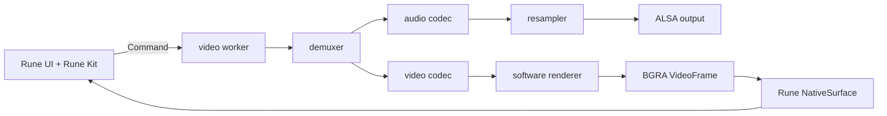

# Veyra architecture

Status labels: **Implemented**, **Partially Implemented**, **Planned**, and **Needs Verification**.

## Structure

```text
src/
├── main.rs
├── app/mod.rs
├── ui/{mod.rs,styles.rs,lucide.rs}
├── playback/mod.rs
├── playlist/mod.rs
├── utils/mod.rs
└── video/
    ├── mod.rs
    ├── commands.rs
    ├── state.rs
    ├── worker.rs
    ├── ffi.rs
    ├── decoder/{mod.rs,demuxer.rs,codec.rs,seek.rs}
    ├── rendering/{mod.rs,decoder.rs,frame.rs,renderer.rs}
    └── audio/{mod.rs,decoder.rs,resampler.rs,output.rs}

├── build.rs
└── wrapper.h
```

`main.rs` only starts `app::run`. `app/mod.rs` is the application bootstrap. `ui/mod.rs` owns the video-first state-driven view, Rune Kit composition, floating overlays, input handlers, chooser integration, and the playback-to-surface handoff. `ui/lucide.rs` contains the embedded icon set and `ui/styles.rs` contains shared glass styling. `playback/mod.rs` exposes the playback façade; the `video/` tree owns native media and device implementation details. `playlist/mod.rs` owns track data and selection.

## Engine boundaries

- `video/commands.rs`: worker command protocol.
- `video/state.rs`: public playback snapshot.
- `video/worker.rs`: command consumption, decoder replacement, pause loop, and shutdown.
- `video/decoder/demuxer.rs`: libavformat container and packet ownership.
- `video/decoder/codec.rs`: stream selection and AVCodecContext lifecycle.
- `video/decoder/seek.rs`: seek and codec flush operations.
- `video/audio/`: audio decode, resampling, volume scaling, and ALSA output.
- `video/rendering/`: software video decode, BGRA frame data, and libswscale conversion.
- `video/ffi.rs`: generated native bindings boundary.



## Ownership and concurrency

`Engine` in `playback/mod.rs` owns a command sender, mutex-protected snapshot/frame handles, and one named `veyra-media-engine` thread. The worker in `video/worker.rs` owns `Decoder`; dropping/replacing it releases FFmpeg, swscale, swresample, and ALSA resources. Rune never receives native decoder or device pointers. The frame handle and `NativeSurface` are both latest-wins slots: publishing a new frame replaces an older unpresented frame. `PresentationClock` in `video/rendering/decoder.rs` applies decoded PTS values in stream time-base seconds before a frame is published, so packet decode speed does not determine playback speed.

The architecture is intentionally simple, but timing synchronization, bounded queues, and a formal playback state machine remain incomplete.
