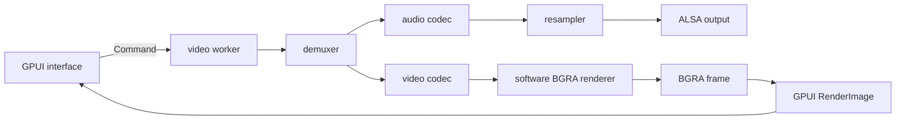

# Veyra architecture

Status labels: **Implemented**, **Partially Implemented**, **Planned**, and **Needs Verification**.

## Structure

```text
.
├── Cargo.toml
├── src/                         # shipped application source
│   ├── main.rs
│   ├── app/{Cargo.toml,src/}
│   ├── cache/{Cargo.toml,src/}
│   ├── playback/{Cargo.toml,src/}
│   ├── playlist/{Cargo.toml,src/}
│   ├── scripting/{Cargo.toml,src/}
│   ├── statistics/{Cargo.toml,src/}
│   ├── ui/{Cargo.toml,src/}
│   ├── utils/{Cargo.toml,src/}
│   ├── video/
│   │   ├── Cargo.toml
│   │   ├── build.rs
│   │   ├── wrapper.h
│   │   └── src/{audio,decoder,rendering,...}
│   └── player/                  # bundled Lua command examples
├── benchmarks/                  # test-data collection, not part of the app
│   ├── benchmark.py
│   └── render_chart.py
├── assets/
├── docs/
├── third_party/
└── video_test/
```

`src/main.rs` only starts `veyra_app::run`. `src/app/src/lib.rs` is the application bootstrap. `src/ui/src/lib.rs` owns the complete GPUI video-first view, floating overlays, input handlers, chooser integration, and the playback-to-image handoff. `src/playback/src/lib.rs` exposes the playback façade; `src/video/src/` owns native media and device implementation details. `src/playlist/src/lib.rs` owns track data and selection. `benchmarks/` stays outside this tree because it only collects test data.

## Engine boundaries

- `src/video/src/commands.rs`: worker command protocol.
- `src/video/src/state.rs`: public playback snapshot.
- `src/video/src/worker.rs`: command consumption, decoder replacement, pause loop, and shutdown.
- `src/video/src/mailbox.rs`: one-frame, latest-wins frame handoff and coalesced UI wakeups.
- `src/video/src/decoder/demuxer.rs`: libavformat container and packet ownership.
- `src/video/src/decoder/codec.rs`: stream selection and AVCodecContext lifecycle.
- `src/video/src/decoder/seek.rs`: seek and codec flush operations.
- `src/video/src/audio/`: audio decode, resampling, volume scaling, and ALSA output.
- `src/video/src/rendering/`: YUV GPU upload, direct compositor frames, software fallback, and timestamp pacing.
- `src/video/src/ffi.rs`: generated native bindings boundary.



## Ownership and concurrency

`Engine` in `src/playback/src/lib.rs` owns a command sender, mutex-protected snapshot handle, `FrameMailbox`, and one named `veyra-media-engine` thread. The worker in `src/video/src/worker.rs` owns `Decoder`; dropping/replacing it releases FFmpeg, swscale, swresample, and ALSA resources. GPUI never receives native decoder or device pointers. The mailbox is latest-wins: publishing a new frame replaces an older unpresented frame; GPUI similarly replaces its prior `RenderImage`. `PresentationClock` in `src/video/src/rendering/decoder.rs` applies decoded PTS values in stream time-base seconds before a frame is published, so packet decode speed does not determine playback speed.

The architecture is intentionally simple, but timing synchronization, bounded queues, and a formal playback state machine remain incomplete.
