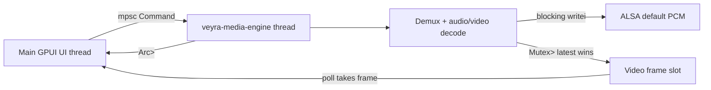

# Veyra media pipeline report

## Scope and result

This report describes the implementation currently in the repository. Veyra uses one Rust worker thread around a custom FFmpeg/ALSA pipeline. GPUI owns the UI and presents the worker's CPU BGRA bytes as a `RenderImage`. libmpv is installed on the host, but is not linked into Veyra and has not replaced the current engine.

The audit found two concrete audio configuration defects: libswresample always produced stereo S16 at 48 kHz, while ALSA was configured from the input frame rate and source channel count. This could play audio at the wrong speed and send a stereo buffer to a PCM configured for a different frame width. ALSA now uses the fixed 48 kHz, two-channel output format. PCM write failures are no longer ignored; recoverable errors use `snd_pcm_recover` and unrecoverable errors reach the worker error state. The audit also found that timeline drags were sending relative seeks based on a stale snapshot; timeline input now sends absolute targets.

Real media playback and A/V measurements were not available in this headless run. The report therefore distinguishes code facts from hypotheses about stuttering.

## Video pipeline

1. `ui::open_path` validates the extension, adds the path to `Playlist`, and calls `Engine::open`.
2. `Engine::open` sends `Command::Open` to the `veyra-media-engine` thread.
3. `Decoder::open` calls `avformat_open_input` and `avformat_find_stream_info` in `decoder/demuxer.rs`, allocates one `AVPacket`, and calls `av_find_best_stream` for video in `decoder/codec.rs`.
4. Codec parameters are copied with `avcodec_parameters_to_context`, then the codec is opened with `avcodec_open2`.
5. The worker repeatedly calls `av_read_frame`. Video packets are sent with `avcodec_send_packet`; decoded frames are drained with `avcodec_receive_frame`.
6. `src/video/src/rendering/renderer.rs` lazily creates a `SwsContext` and calls `sws_scale` to produce a portable BGRA frame for GPUI.
7. `best_effort_timestamp`, falling back to `pts`, is converted using the selected stream time base. `PresentationClock` uses `Instant` and sleeps until the timestamp deadline before publishing.
8. The worker stores one `VideoFrame` in `FrameMailbox`. Publishing replaces the previous unconsumed frame, so the queue is bounded at one and is latest-wins; source-frame wakes are coalesced.
9. `ui::poll` takes the frame, builds a GPUI `RenderImage`, and displays it letterboxed in the video canvas.

The default video path is CPU decode, BGRA conversion, GPUI image upload, then GPU presentation. It is not a hardware decoder or an FFmpeg-to-wgpu zero-copy path.

## Audio pipeline

1. Audio packets are read by the same `av_read_frame` loop and routed by stream index.
2. Audio packets are sent with `avcodec_send_packet`; frames are drained with `avcodec_receive_frame`.
3. The first decoded frame creates `AudioOutput`. `audio/resampler.rs` configures `swr_alloc_set_opts2` and `swr_init` for stereo, signed 16-bit interleaved output at 48,000 Hz.
4. Each frame allocates a byte buffer, calls `swr_convert`, applies volume/mute scaling to 16-bit samples, and calls `snd_pcm_writei`.
5. `AudioOutput::open` configures the ALSA default PCM with `snd_pcm_set_params`, interleaved access, two channels, S16 little endian, and 48,000 Hz output. These settings match the resampler output. `AudioOutput::write` handles short writes and calls `snd_pcm_recover` after a negative `snd_pcm_writei` result.

There is no separate audio queue, audio thread, audio clock, underrun recovery loop, or explicit `snd_pcm_recover` handling. `snd_pcm_writei` can block the only media worker. Audio timestamps are not used to schedule output; ALSA consumption is the effective audio clock.

## Synchronization

The current synchronization is incomplete:

- Video is scheduled from its first decoded timestamp using a monotonic `Instant`.
- Audio is paced by blocking ALSA writes at 48 kHz.
- There is no shared audio master clock.
- The worker demuxes, decodes audio, converts video, sleeps for video deadlines, and publishes frames serially.
- Video pacing can delay processing of subsequent audio packets; blocking ALSA writes can delay video packets.
- A one-frame latest-wins slot can discard frames when conversion or UI upload falls behind.
- Seeking flushes the demuxer and codec state, drops queued ALSA samples by dropping the `AudioOutput`, clears the pending video frame, and resets the video clock. Timeline seeking uses an absolute target; keyboard transport remains relative.

The input-rate/output-rate mismatch was a confirmed cause of incorrect audio speed and is fixed in code. The remaining A/V drift and stutter behavior require a real media test because the current environment cannot exercise the native chooser or collect audio/video clocks.

## Threads and communication

`Engine` owns the command sender, snapshot handle, frame handle, and worker join handle. `Decoder` and native FFmpeg/ALSA pointers stay on the worker. The UI only reads cloned snapshots and takes owned frame buffers. There are no audio/video worker threads and no packet or decoded-frame queues.

## Rendering implementation and bottlenecks

GPUI provides the window, native decorations, UI composition, and image presentation. Veyra creates a `RenderImage` from each presented BGRA buffer. The custom renderer allocates and fills a complete BGRA buffer per presented frame. The UI poll loop wakes approximately every 16 ms and takes at most the newest frame.

Likely cost centers from code inspection are the synchronous worker design, `sws_scale`, per-frame full-buffer allocation, one-frame replacement, blocking ALSA writes, and video-clock sleeps that prevent packet processing. These are identified implementation risks, not measured profiles. Hardware decoding is not configured. No real FPS, CPU, memory, dropped-frame, or display-refresh measurement was produced in this audit.

## Relevant dependencies

| Dependency | Version/source | Actual role |
| --- | --- | --- |
| libavformat | 62.3.100 | Container opening, stream discovery, packet reading, seeking |
| libavcodec | 62.11.100 | Audio/video codec contexts and packet/frame decode |
| libavutil | 60.8.100 | FFmpeg types, timestamps, channel layouts and sample formats |
| libswscale | 9.1.100 | CPU conversion to BGRA |
| libswresample | 6.1.100 | Conversion to stereo S16 at 48 kHz |
| ALSA | 1.2.15.3 | Default PCM configuration and blocking sample writes |
| GPUI | 0.2.2 | Native window, layout, input, renderer and image presentation |
| bindgen | 0.72.1 | Build-time Rust bindings for FFmpeg and ALSA headers |
| libc | 0.2.191 | Direct Rust dependency; no separate playback role in the audited path |

`build.rs` links `avformat`, `avcodec`, `avutil`, `swscale`, `swresample`, and `asound`, then generates bindings from `wrapper.h`.

## Known limitations and libmpv migration

The current engine is useful as a working prototype, but its single-worker and CPU-frame architecture is a poor long-term basis for mpv-level playback. libmpv would replace demuxing, codec selection, decode scheduling, buffering, audio output, clocks, seeking and playlist media state. The GPUI interface, controls, playlist presentation, fullscreen action and state projection would remain.

The host provides libmpv 0.41.0 and headers. The current GPUI frontend accepts CPU image data, so an external-texture bridge remains future work. A prior Rune-focused OpenGL/EGL/FBO investigation is retained in `docs/libmpv-rendering.md` as historical research. The current engine must remain until a prototype renders real media inside GPUI and its cost is measured.
